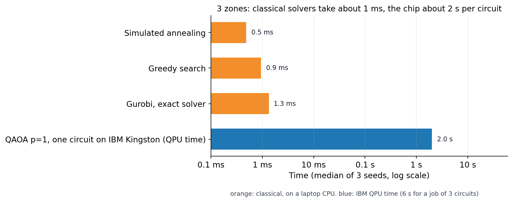
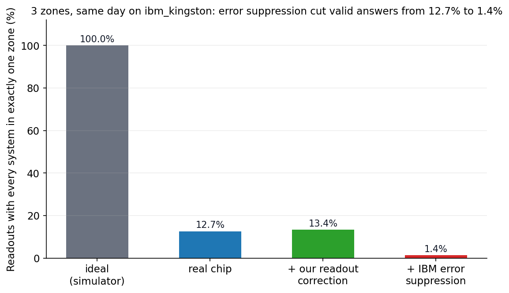

# Q-Segment

Network zoning that balances security and business. Q-Segment splits a network into zones so that one hacked machine cannot reach everything, while the traffic the business needs keeps flowing.

- **Live demo:** https://q-segment.up.railway.app (draw a network, press **Segment my network**, then try **Simulate breach** in the zoned view)
- **Built for:** Qiskit Fall Fest hackathon, FAU, 17-18 Oct 2026

## The problem in one paragraph

Every link between two systems has a **traffic** value (how much the business needs them to talk) and a **risk** value (how much damage spreads if an attacker on one reaches the other). A split into zones costs the traffic on links that cross zones (each needs a firewall rule) plus the risk on links kept inside a zone. With `w = risk - traffic` per link, finding the cheapest split is a **signed Max-k-Cut** problem. We solve it for **3 zones** with QAOA in Qiskit.

## What we found (3 zones, 8 systems, 21 qubits)





- A valid chip readout is the best split **0.94%** of the time (**1.87%** in ideal simulation); post-processing then reaches the best split.
- At **60-150 systems**, Gurobi could not prove the best answer in any of **12 runs** (60 s each).

**Honest conclusion:** today a normal computer is far faster, and we make no speedup claim. Larger networks would need hundreds of qubits with much lower noise (297 qubits at 100 systems; ibm_kingston has 156).

## What we built vs what we reused

**Reused:** Qiskit (`QAOAAnsatz`, `StatePreparation`, `XXPlusYYGate`, `SparsePauliOp`, `transpile`), Qiskit Aer and IBM Runtime `SamplerV2`, SciPy's COBYLA optimizer, Gurobi for the classical comparison, and the standard QAOA and Max-Cut ideas (Farhi et al. 2014).

**Built by us:**
- The formulation of network microsegmentation as signed Max-3-Cut with traffic and risk per link, and its QUBO and Ising forms (`research/qsegment/formulation.py`).
- A 3-zone QAOA circuit with one-hot encoding: each system starts in a W state over its 3 zone qubits, and a ring mixer of `XXPlusYY` gates keeps every system in exactly one zone (`research/qsegment/circuits.py`).
- An exact simulator restricted to valid splits, used to tune angles (`research/qsegment/subspace.py`).
- Post-processing: steepest-descent local search that starts from each chip readout (`research/qsegment/postprocess.py`).
- Readout correction from two calibration circuits in the same IBM job (`research/qsegment/mitigation.py`).
- Classical baselines (exhaustive search, greedy, simulated annealing) and the experiments in `research/experiments`.
- The web app and its FastAPI + Qiskit backend (`app/`).

## Repository layout

```
app/                  web app (FastAPI server, Qiskit solver, IBM runs, page)
research/
  qsegment/           core code: formulation, circuits, QAOA, mitigation, baselines
  experiments/        numbered scripts; 08-17 are the 3-zone results, 01-07 the earlier 2-zone version
  results/            JSON output of every experiment, including raw chip counts
  notebooks/          01_circuit (the circuit), 02_all_results (tables), 03_hackathon_figures (figures)
  figures/            the charts shown above
```

## Reproduce the research results

```bash
cd research
pip install -r requirements.txt
python experiments/08_verify_3zone.py      # checks QUBO, Ising and circuit against brute force
python experiments/09_baselines_3zone.py   # classical baselines (needs gurobipy)
python experiments/10_qaoa_3zone.py        # QAOA in simulation, 3 seeds
jupyter notebook notebooks/                # open 02_all_results.ipynb for every table
```

## Run the web app locally

```bash
pip install -r requirements.txt
uvicorn app.main:app --reload
```

Open http://localhost:8000. The app needs only the root `requirements.txt`, not the research one.

### Real IBM runs from the app

Switched on only when these server variables are set (never commit them):

- `QSEGMENT_ACCESS_CODE`: the code people type on the page.
- `IBM_QUANTUM_TOKEN`: IBM Quantum API key. `IBM_QUANTUM_INSTANCE` is optional.

## Limits we know about

- Traffic and risk values in the demo are illustrative, not real company data.
- 8 systems is a demo size. Real networks have thousands of systems.
